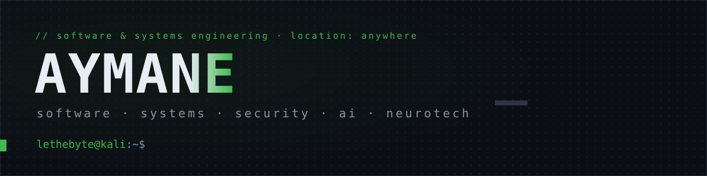

  

# Aymane Amounas - Software & Systems Engineering

I'm a software and systems engineering student. Most of what I build is local-first, so it runs on your own machine instead of someone else's server. Lately I keep circling the same question: how do you let an AI model do real work without handing it the keys to everything? A lot of my projects are some version of putting honest boundaries around what code is actually allowed to do.

Here are the ones I spend the most time on. I ordered them by how close they are to what I care about right now, not by how finished they are.

## Venus Agent

This is the one I care about most. It's a runtime in Rust for AI agents, built on a simple rule: the model can propose an action, but nothing runs until it clears a permission check, and for anything that matters, an explicit approval from me. Every decision gets written to an audit log so I can go back and see what happened. It's still in development, and it's meant to be a reusable runtime you build on top of, not a finished assistant you chat with.

[Demo](https://github.com/aymane-amounas/venusAgent/blob/main/docs/demo.md) · [Repository](https://github.com/aymane-amounas/venusAgent)

## WekI

An offline Wikipedia reader. It reads the original content from a local ZIM archive and keeps newer versions of articles in a SQLite layer on top, so the archive itself never gets touched. Still experimental.

[Demo and screenshots](https://github.com/aymane-amounas/WekI#screenshots) · [Repository](https://github.com/aymane-amounas/WekI)

## AgentTrace

Local-first observability for agent runs. It records structured spans for every model call and tool call, lets you inspect and replay a run, and redacts secrets before anything is written to storage. This one is built.

[Screenshot](https://github.com/aymane-amounas/agenttrace/blob/main/docs/assets/trace-detail.jpg) · [Repository](https://github.com/aymane-amounas/agenttrace)

## A few more

**PhishLab** is an offline-first phishing investigation workbench. It parses suspicious emails, defangs the indicators, and inspects attachments without ever executing them, then writes up evidence-based reports. Built. [Demo](https://github.com/aymane-amounas/phishlab/blob/main/docs/demo.md) · [Repository](https://github.com/aymane-amounas/phishlab)

**jarvS** is a local-first personal assistant. Python does the reasoning, Rust handles execution behind a permission gate, and Ollama runs the model locally. The difference from Venus Agent is that Venus is the reusable runtime and jarvS is the end-user assistant built around that same controlled execution. Built. [Demo](https://github.com/aymane-amounas/jarvS/blob/main/docs/DEMO.md) · [Repository](https://github.com/aymane-amounas/jarvS)

**Canvas Course Downloader** archives Canvas course content offline: modules, files, pages, assignments, and supported media. Built. [Usage](https://github.com/aymane-amounas/Canvas-Course-Downloader#usage) · [Repository](https://github.com/aymane-amounas/Canvas-Course-Downloader)

[View all repositories](https://github.com/aymane-amounas?tab=repositories)

## What I'm into

Systems engineering and understanding how things behave end to end, local-first and offline software, AI infrastructure with bounded tool access and permissioned execution, and the security side that runs through all of it.

## Stack

A rough map of what I reach for, not a claim that I'm equally deep in every one.

Languages  

Application development  

Storage and offline data  

Local AI  

## Contact

[GitHub](https://github.com/aymane-amounas) · [LinkedIn](https://www.linkedin.com/in/aymane-amounas/)

Built by [Aymane](https://github.com/aymane-amounas)
