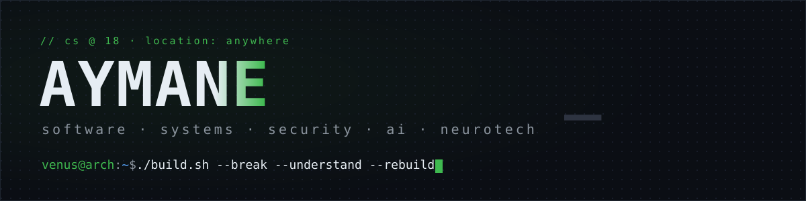

  

# Hey, I'm Aymane . aka Venus.

`CS @ 18` · I build software, break systems, and (sometimes) fix them again.

I care about how a thing works all the way down: software engineering, systems, cybersecurity, AI, and neurotech. Give me something that works and I'll want to know why. Give me something that doesn't and I'll want to know *why not*.

---

### What I'm building

| Project | What it is | Stack | Status |
|:---|:---|:---|:---|
| [WekI](https://github.com/aymane-amounas/WekI) | Offline Wikipedia reader. Read local, sync when you're back online. | `Python` | building |
| [Venus Agent](https://github.com/aymane-amounas/venusAgent) | Rust agent runtime . providers, capabilities, permissions. | `Rust` | early |
| [jarvS](https://github.com/aymane-amounas/jarvS) | Local-first personal AI agent. Ollama + permissioned tools. | `Rust` · `Python` | active |
| more… | there's always something cooking. | | . |

### What I'm into

- **Systems & software** . reliable apps, understood end to end, nothing magic.
- **Cybersecurity** . networking, Linux, offense and defense.
- **AI systems** . local models, agent runtimes, tools that run under permission not vibes.
- **Neurotech** . where computing meets the nervous system. Early, but watch this space.

### Stack

  
  
  
  
  
  
  
  

- **Build it. Understand it. Break it. Make it better.**
- **Have the courage to follow Ur heart and intuition**
- **And Do not forget to HAVE FUN WITH IT**

---

[GitHub](https://github.com/aymane-amounas) · [LinkedIn](https://www.linkedin.com/in/aymane-amounas/)

Built by [Aymane](https://github.com/aymane-amounas)
